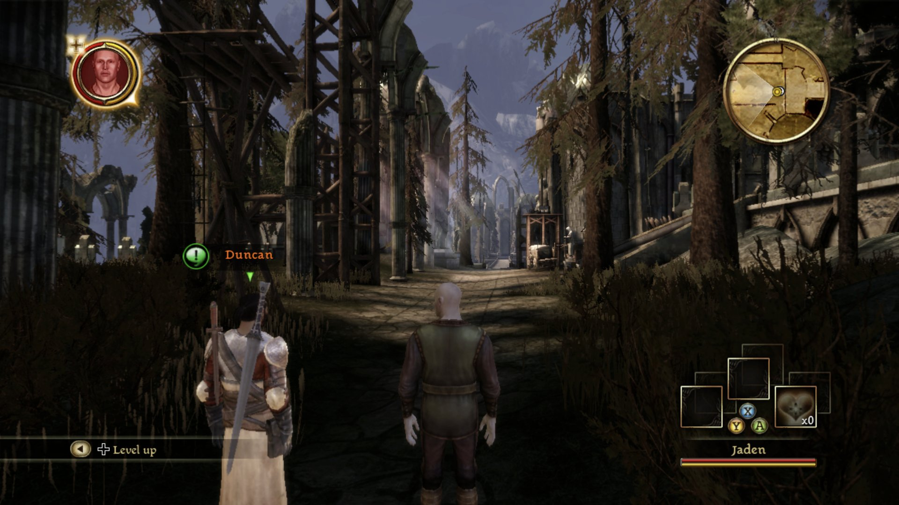
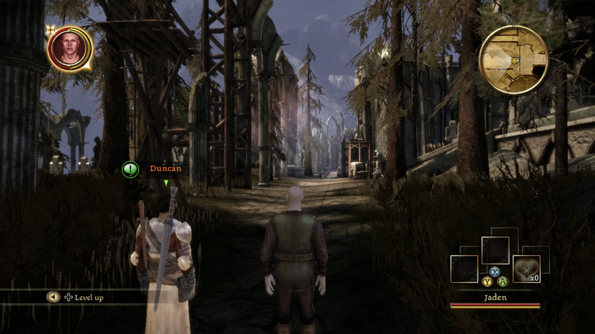

# Imported Vulkan drivers, measured (PLAN 9.23)

This page covers the experimental **Vulkan driver** option on the AYN Thor: which driver packages
load, how fast each one runs the game, and what each one does with every upscaling and frame
generation choice. The test is run with `tools/driver_matrix.py`. Every run's data is kept in
[`data/vulkan-drivers/`](data/vulkan-drivers/):

- **`matrix.csv`:** one row a run.
- **`run<N>.txt`:** each run's settings, its GPU samples, and the log lines that matter.
- **`shot<N>.jpg`:** the warm checks' screenshots.

The tables below are made from `matrix.csv` with `python tools/driver_report.py`.
`docs/DECISIONS.md` D17 records the decision this test supports.

## Since the first matrix: the fence watch (PLAN 9.24, BUG-122)

**The full matrix and its summary below were measured before this fix.** On Turnip builds older
than 2026-10-08, those numbers are half of what the drivers do now.

**The cause** (`docs/BUGS.md` BUG-122):
- Xenia asked each pending fence's status at every submission it began.
- Turnip on Qualcomm's kernel driver, before Mesa commit e984ef29 (2026-10-08), turned that
  question into a wait for the GPU.
- So the command processor stood still while the GPU drained, and the GPU then stood idle at a
  low clock.

**The fix is in the app.** A thread waits on the fences in order (`warden_fence_watch.cc`), and
Xenia reads its number instead.

The same build with it, Bilinear at 1280x720 to 1920x1080, no frame generation, uncapped:

| Driver | Before (first matrix) | With the fence watch | GPU | Picture |
|---|---|---|---|---|
| System (v676.53) | 41.9 fps | 41.8 (run 879), 41.6 (891) | 99%, 680 MHz | the reference (shot 891) |
| Turnip T30 (Mr_Purple_666) | 23.1 | 42.9 (880), 43.2 (895) | 99%, 680 MHz | alike (shot 895) |
| Qualcomm 840 | 41.9 | 42.0 (882), 41.6 (896) | 99%, 680 MHz | alike (shot 896) |
| Turnip Balemuni Apex v2 ULTIMATE | 24.1 | 45.2 (883), 45.2 (897) | 99%, 680 MHz | alike (shot 897) |
| Turnip v27.0.0-R2 (StevenMXZ) | 45.6 | 44.7 (884), 44.8 (893) | 99%, 680 MHz | alike (shot 893) |
| Turnip v26.0.0 R8 (K11MCH1) | 32.0 | 76.3 (881), 76.2 (892) | 99%, 680 MHz | **black** (shot 892, BUG-123) |

"Alike" means within 2.6 levels out of 255 of the system's screenshot, from moving foliage
and animation.
- **No frame generation:** every driver that draws correctly now matches the system's driver or
  beats it, by up to 8% (Balemuni).
- **R8 draws nothing,** not even the game's own frames. Its numbers here and in the first
  matrix measure a black screen.

**Lossless 2x is still slower on every imported driver** (Bilinear, runs 885-890):

| Driver | Game fps | Frames shown | lsfg-vk's GPU ms a generated frame |
|---|---|---|---|
| System | 31.2 | 62.3 | 6.8 |
| Turnip T30 | 24.6 | 49.2 | 10.0 |
| Qualcomm 840 | 27.1 | 54.2 | 11.6 |
| Turnip Balemuni Apex v2 | 25.8 | 51.4 | 15.7 |
| Turnip v27.0.0-R2 (StevenMXZ) | 29.1 | 58.0 | 10.8 |

**The generator's own GPU work is the gap.** Ruled out so far:
- **The clock:** all run at 680 MHz now.
- **lsfg-vk's memory types:** Qualcomm 840 picks the system's.
- **Its queue:** Qualcomm 840 has its own, as the system's driver does, and is slow too.
- **32-bit shaders** (`files/frame-generation-fp16` set to `off`; runs 898-901) are slower on every
  driver: System 10.7 ms, Qualcomm 840 17.9, and on the Turnips 232 ms (T30) and 357 ms
  (StevenMXZ), the game at 2.7 frames a second. 16-bit stays.

**The same at 720p, Bilinear, frame rate 120, the next day** (runs 902-911, the owner's
choice in place of the full matrix): the numbers repeat. No frame generation:

| Driver | Game fps |
|---|---|
| System | 41.7 |
| Turnip T30 | 43.1 |
| Qualcomm 840 | 41.5 |
| Turnip Balemuni Apex v2 | 46.5 |
| Turnip v27.0.0-R2 (StevenMXZ) | 45.4 |

Lossless 2x: 30.9, 24.9, 27.4, 25.9 and 29.3. Every screenshot is within 2.8 levels out of 255
of the system's.

### Lossless 2x pass by pass

`files/frame-generation-timing` set to `passes` writes timestamps around lsfg-vk's shader chains
(`warden_lsfg.cc`). The table is GPU ms per generated frame, 300 frames each; the "full-size"
gamma/delta level is the last of the seven, at the frame's own size.

| Pass | System | Turnip T30 | Qualcomm 840 | Balemuni | StevenMXZ |
|---|---|---|---|---|---|
| mipmaps | 0.18 | 0.10 | 0.19 | 0.21 | 0.17 |
| alpha | 0.88 | **3.23** | 1.01 | **5.06** | **2.27** |
| beta | 0.28 | 0.19 | **6.77** | 0.30 | 0.30 |
| gamma/delta, levels 1-6 | 1.43 | 1.70 | 1.03 | 2.64 | 2.10 |
| gamma/delta, full size | 3.11 | **4.09** | 1.68 | **6.47** | **4.88** |
| generate | 0.16 | 0.11 | 0.17 | 0.17 | 0.17 |
| the whole generation | 6.78 | 9.89 | 11.60 | 15.60 | 10.64 |

The runs are 912-916, all 16-bit.

**With 32-bit shaders** (runs 917-919), the same passes:

| Pass | System | Qualcomm 840 | StevenMXZ |
|---|---|---|---|
| alpha | 1.02 | 3.10 | 71.55 |
| beta | 2.02 | **3.40** | 0.30 |
| full-size gamma/delta | 4.72 | 7.23 | 203.64 |

**What it means:**
- **The gap is in a few of lsfg-vk's own shaders, compiled differently by each driver.**
- **Qualcomm 840's is one pass:** beta, whose last shader (resource 328) runs 1,024 threads a
  workgroup with shared memory and five barriers to build six mip levels. It is 24 times
  System's in 16-bit and half that in 32-bit. Meanwhile 840 runs the biggest pass, the
  full-size gamma/delta, at almost twice System's speed.
- **The Turnips are slower on alpha and the full-size gamma/delta.** These are straight-line,
  8×8, heavy in 16-bit math (up to 922 operations, explicit-LOD sampling, RGBA8 writes). In
  32-bit they collapse (StevenMXZ's alpha 71.6 ms): Mesa's compiler on this kind of shader.
- **The shaders are already optimized.** `spirv-opt -O` takes off only 2-10% of their
  instructions, checked on the computer with the owner's own `Lossless.dll`, which is never in
  the repository.

**What the app could do:**
- **Choose the precision per pass:** measure both at the generator's start and keep the faster.
  That would bring Qualcomm 840 from 11.6 to about 7.5 ms (System 6.8), and does nothing for
  Turnip.
- **Turnip's gap is the driver's compiler.** No app-side change to the shaders found closes it
  (PLAN 9.24).

## The first matrix's summary (before the fence watch)

At Ostagar's King's Camp, uncapped, on the AYN Thor (all 102 matrix runs, 6 drivers × 17
combinations, plus the smoke runs and warm checks; every run reached the camp with no faults):

- **Turnip v27.0.0-R2 (StevenMXZ, 2026-11-07) is the fastest driver measured.** Against the
  system's driver it is ahead where frame generation is off or is FSR 3.1's:

  | Combination | System's driver | StevenMXZ | Gain |
  |---|---|---|---|
  | Bilinear | 41.9 fps | 45.6 fps | +9% |
  | FSR 3.1 Performance | 37.5 fps | 42.8 fps | +14% |
  | FSR 3.1 Performance with FSR 3.1 2x, frames shown | 54.8 a second | 60.7 a second | +11% |

  It keeps the GPU 99% busy at its top clock (680 MHz), as the system's driver does. It draws
  the camp as the system's driver does (screenshots below, the static scenery within 2 levels
  out of 255). The warm check agrees: 45.1 fps against the system's 41.1.
- **Lossless 2x is slower on every imported driver.** On StevenMXZ's it gives 29.6 game fps
  against the system's 31.4 (Bilinear), and on Qualcomm 840 27.1. The system's driver is
  still the best for Lossless 2x.
- **The other Qualcomm drivers match the system's driver,** within a frame a second (805,
  819.2, 837.6, 840: the smoke runs 40.7-42.2 fps). Qualcomm 840 is 10-20% behind with
  Lossless 2x.
- **The other Turnip builds are slow:**

  | Driver | Bilinear | GPU busy | GPU clock |
  |---|---|---|---|
  | Mr_Purple_666's T30 | 23 fps | 72-75% | 401-475 MHz without frame generation |
  | K11MCH1's v26.0.0 R8 | 32 fps | 63-68% | 401-475 MHz without frame generation |
  | Balemuni Apex v2 ULTIMATE | 24 fps | 72-75% | 401-475 MHz without frame generation |

  This is D16's finding (2026-11-03): the GPU part idle. The Adreno's governor then keeps the
  clock low. The heavier Lossless 2x work raises it. Why StevenMXZ's newer Mesa does not do
  this was not looked into. Balemuni's is tuned for this chip family (SD 8 Gen 2), and it is
  still among the slowest.
- **FSR 3.1 works on every driver that loads,** both its upscaler and its frame generation.
  On Turnip this needed the SDK patched (BUG-112).
- **The render resolution:**
  - Without FSR 3.1, every run renders at 1280x720, and the presenter's upscaler takes it to
    the panel's 1920x1080. Lossless 2x then generates at 1280x720, before the upscale.
  - FSR 3.1 renders at 1280x720 (Quality), 1120x630 (Balanced) or 960x540 (Performance) and
    upscales to 1920x1080. Both kinds of frame generation then work at 1920x1080.
- **Heat.** The GPU's highest temperature was 68-73 C on the system's, Qualcomm 840's and
  StevenMXZ's drivers, and 54-67 C on the slow Turnip builds. That follows the GPU's load.

**What it means for a player:** System stays the default and the tested driver.
- **For FSR 3.1, or no frame generation:** StevenMXZ's Turnip v27.0.0-R2 is worth trying
  under Experimental. It is about 10% faster at the camp, but has been looked at only there.
- **With Lossless 2x:** stay on System.

## How it was measured

**The device:**
- The AYN Thor: Snapdragon 8 Gen 2, Adreno 740, Android 13, its 1920x1080 main panel at 120 Hz.
- The system's own driver is Qualcomm v676.53 (`0x802A4035`).
- The debug app of 2026-11-16 (session 47).

**One run is one boot.** `tools/measure_ostagar.sh` with the ostagar route:
1. The app boots straight into the game, and the route loads into Ostagar's King's Camp.
2. It waits for the camp, then lets the game settle for 15 s.
3. It samples the GPU's busy percentage, its clock and its temperature once a second for 20 s.

The measures:
- **Game fps and 1% low:** the game's own frames, from the last four of the runtime's
  5-second `frames:` lines.
- **Frames shown a second:** the frames presented to the panel, generated ones included.

**The settings every run shares:**

| Setting | Value |
|---|---|
| Frame rate | 120 (the game uncapped, so the GPU decides the rate) |
| Rendering resolution | 1280x720 |
| Dynamic shadows | On |
| Corner vignette | On |
| Shader math | Exact |
| Texture filtering | 16x |

**The 17 combinations:**
- **FSR 3.1 off:** each of the presenter's four upscalers (Bilinear, FXAA, FSR 1, CAS), each
  with frame generation off and with Lossless 2x.
- **FSR 3.1 Quality, Balanced and Performance:** each with frame generation off, Lossless 2x
  and FSR 3.1 2x. FSR 3.1's own frame generation needs FSR 3.1's upscaler on.
- **Lossless 2x** is lsfg-vk with the owner's `Lossless.dll`.

**Order.** The matrix runs every driver on one combination before moving to the next
(`--interleave`), so the handheld warming over hours falls on each driver alike. The GPU stayed
between 54 and 74 C, under the heat guard's 75 C (and the heat guard is off by default).

**Rounds:**
1. **System, Turnip T30, Turnip v26.0.0 R8 and Qualcomm 840:** runs 765-832. The packages that
   load were smoke-run first (runs 758-764), which also filled each one's pipeline cache.
2. **Balemuni and StevenMXZ:** runs 833-866, added at the owner's ask the same day. Their first
   run started with an empty pipeline cache.
3. **Warm checks:** a Bilinear run again for the system and the two new drivers, each with a
   screenshot (runs 867-869).

## The drivers

| Driver | Where from | Package SHA-256 (first 16) | Device name / version | On the Thor |
|---|---|---|---|---|
| System (Qualcomm v676.53) | the Thor's own | - | Adreno (TM) 740, `0x802A4035` | the reference |
| Qualcomm 805 | K11MCH1/AdrenoToolsDrivers | `2065acf6298383a3` | Adreno (TM) 740, `0x80325000` | loads; smoke run only |
| Qualcomm 819.2 | K11MCH1/AdrenoToolsDrivers | `50d2b9e051cc8f26` | Adreno (TM) 740, `0x80333002` | loads; smoke run only |
| Qualcomm 837.6 | K11MCH1/AdrenoToolsDrivers | `ad12f6788cb5d521` | Adreno (TM) 740, `0x80345006` | loads; smoke run only |
| Qualcomm 840 | K11MCH1/AdrenoToolsDrivers | `b3552a18196a74d6` | Adreno (TM) 740, `0x80348000` | loads; the full matrix |
| Qualcomm 849 | K11MCH1/AdrenoToolsDrivers | `3e193ed6b271a519` | - | **does not load**: needs `android.hardware.graphics.allocator-V2-ndk.so` (Android 14). The system's driver ran in its place (BUG-120) |
| Qualcomm v676.53 (package) | K11MCH1/AdrenoToolsDrivers | `59b7056b58090779` | - | the system's own version: not measured |
| Turnip T30 (Mr_Purple_666) | the package D16's test used (2026-11-03) | `f65b2d3353fd4aa7` | PurpleVK-public Adreno (TM) 740, `0x6802063` | loads; the full matrix |
| Turnip T29 (Mr_Purple_666) | the same | `606d5c1d7fa3e544` | - | **does not load**: needs `pthread_getaffinity_np` (Android 14's libc) |
| Turnip v26.0.0 R8 | K11MCH1/AdrenoToolsDrivers | `e634db0f929e2205` | Turnip Adreno (TM) 740, `0x6463063` | loads, but **draws every frame black** (BUG-123); its numbers measure a black screen |
| Turnip Balemuni Apex v2 ULTIMATE (SD 8 Gen 2) | Balemuni/Balemunis-Aurora, release `V2` (2026-08-26; Mesa 26.3.0-devel b9a2bf3) | `810567af3bc849b3` | Turnip Adreno (TM) 740, `0x6802063` | loads; the full matrix |
| Turnip v27.0.0-R2 (StevenMXZ, A7xx) | StevenMXZ/Adreno-Tools-Drivers, release `v39` (2026-11-07; the file `Turnip_v27.0.0-R2.zip`) | `8d30be022582d0c0` | Turnip Adreno (TM) 740, `0x6863063` | loads; the full matrix |

The packages' SHA-256s match the digests their GitHub releases publish (Balemuni's and
StevenMXZ's checked on download). No package is in the repository.

## Results

The first matrix (before the fence watch; R8 drew black), then the other runs by their note.

#### What each combination renders at and is upscaled to

| Combination | Rendered at | Upscaled to | By | Frame generation at |
|---|---|---|---|---|
| Bilinear, no frame generation | 1280x720 | 1920x1080 | Bilinear (presenter) | - |
| Bilinear, Lossless 2x | 1280x720 | 1920x1080 | Bilinear (presenter) | 1280x720 |
| FXAA, no frame generation | 1280x720 | 1920x1080 | FXAA (presenter) | - |
| FXAA, Lossless 2x | 1280x720 | 1920x1080 | FXAA (presenter) | 1280x720 |
| FSR 1, no frame generation | 1280x720 | 1920x1080 | FSR 1 (presenter) | - |
| FSR 1, Lossless 2x | 1280x720 | 1920x1080 | FSR 1 (presenter) | 1280x720 |
| CAS, no frame generation | 1280x720 | 1920x1080 | CAS (presenter) | - |
| CAS, Lossless 2x | 1280x720 | 1920x1080 | CAS (presenter) | 1280x720 |
| FSR 3.1 Quality, no frame generation | 1280x720 | 1920x1080 | FSR 3.1 | - |
| FSR 3.1 Quality, Lossless 2x | 1280x720 | 1920x1080 | FSR 3.1 | 1920x1080 |
| FSR 3.1 Quality, FSR 3.1 2x | 1280x720 | 1920x1080 | FSR 3.1 | 1920x1080 |
| FSR 3.1 Balanced, no frame generation | 1120x630 | 1920x1080 | FSR 3.1 | - |
| FSR 3.1 Balanced, Lossless 2x | 1120x630 | 1920x1080 | FSR 3.1 | 1920x1080 |
| FSR 3.1 Balanced, FSR 3.1 2x | 1120x630 | 1920x1080 | FSR 3.1 | 1920x1080 |
| FSR 3.1 Performance, no frame generation | 960x540 | 1920x1080 | FSR 3.1 | - |
| FSR 3.1 Performance, Lossless 2x | 960x540 | 1920x1080 | FSR 3.1 | 1920x1080 |
| FSR 3.1 Performance, FSR 3.1 2x | 960x540 | 1920x1080 | FSR 3.1 | 1920x1080 |

#### The game's frames a second (the title's swaps, the 20 s measured)

| Combination | System (v676.53) | Turnip T30 (Mr_Purple_666) | Turnip v26.0.0 R8 (K11MCH1) | Qualcomm Adreno 840 | Turnip Balemuni Apex v2 ULTIMATE | Turnip v27.0.0-R2 (StevenMXZ) |
|---|---|---|---|---|---|---|
| Bilinear, no frame generation | 41.9 | 23.1 | 32.0 | 41.9 | 24.1 | 45.6 |
| Bilinear, Lossless 2x | 31.4 | 19.1 | 20.9 | 27.1 | 17.9 | 29.6 |
| FXAA, no frame generation | 40.4 | 20.9 | 32.4 | 41.0 | 21.8 | 45.5 |
| FXAA, Lossless 2x | 30.6 | 18.6 | 20.9 | 27.1 | 19.5 | 29.0 |
| FSR 1, no frame generation | 39.1 | 22.9 | 32.6 | 39.8 | 22.4 | 43.1 |
| FSR 1, Lossless 2x | 29.1 | 19.5 | 22.1 | 25.9 | 19.4 | 27.9 |
| CAS, no frame generation | 40.0 | 22.9 | 32.4 | 40.8 | 22.1 | 44.5 |
| CAS, Lossless 2x | 30.4 | 19.1 | 22.3 | 26.8 | 19.1 | 28.5 |
| FSR 3.1 Quality, no frame generation | 29.4 | 20.3 | 23.2 | 30.6 | 19.6 | 33.8 |
| FSR 3.1 Quality, Lossless 2x | 20.8 | 13.4 | 15.8 | 17.4 | 13.5 | 19.2 |
| FSR 3.1 Quality, FSR 3.1 2x | 21.2 | 18.1 | 18.6 | 22.1 | 18.1 | 23.5 |
| FSR 3.1 Balanced, no frame generation | 33.0 | 20.1 | 24.5 | 34.5 | 21.2 | 38.2 |
| FSR 3.1 Balanced, Lossless 2x | 22.6 | 13.9 | 16.1 | 18.5 | 14.2 | 20.6 |
| FSR 3.1 Balanced, FSR 3.1 2x | 24.2 | 18.6 | 19.8 | 24.9 | 18.9 | 26.5 |
| FSR 3.1 Performance, no frame generation | 37.5 | 19.8 | 25.4 | 38.4 | 20.9 | 42.8 |
| FSR 3.1 Performance, Lossless 2x | 24.5 | 14.4 | 16.4 | 19.7 | 14.7 | 21.8 |
| FSR 3.1 Performance, FSR 3.1 2x | 27.4 | 18.5 | 21.0 | 28.2 | 19.4 | 30.3 |

#### Frames shown a second (presents; with frame generation, the generated ones too)

| Combination | System (v676.53) | Turnip T30 (Mr_Purple_666) | Turnip v26.0.0 R8 (K11MCH1) | Qualcomm Adreno 840 | Turnip Balemuni Apex v2 ULTIMATE | Turnip v27.0.0-R2 (StevenMXZ) |
|---|---|---|---|---|---|---|
| Bilinear, no frame generation | 41.9 | 23.1 | 32.0 | 41.9 | 24.2 | 45.6 |
| Bilinear, Lossless 2x | 62.7 | 38.2 | 41.8 | 54.0 | 35.7 | 59.2 |
| FXAA, no frame generation | 40.4 | 20.9 | 32.4 | 41.0 | 21.9 | 45.5 |
| FXAA, Lossless 2x | 61.3 | 37.3 | 41.8 | 54.1 | 38.9 | 57.8 |
| FSR 1, no frame generation | 39.1 | 22.9 | 32.6 | 39.8 | 22.4 | 43.2 |
| FSR 1, Lossless 2x | 58.2 | 39.0 | 44.2 | 51.7 | 38.9 | 55.8 |
| CAS, no frame generation | 40.0 | 22.9 | 32.4 | 40.8 | 22.1 | 44.5 |
| CAS, Lossless 2x | 60.9 | 38.3 | 44.6 | 53.6 | 38.3 | 57.1 |
| FSR 3.1 Quality, no frame generation | 29.5 | 20.4 | 23.2 | 30.7 | 19.5 | 33.8 |
| FSR 3.1 Quality, Lossless 2x | 41.6 | 26.7 | 31.5 | 34.8 | 27.1 | 38.4 |
| FSR 3.1 Quality, FSR 3.1 2x | 42.4 | 36.2 | 37.2 | 44.0 | 36.2 | 47.0 |
| FSR 3.1 Balanced, no frame generation | 33.0 | 20.1 | 24.5 | 34.5 | 21.2 | 38.2 |
| FSR 3.1 Balanced, Lossless 2x | 45.2 | 27.9 | 32.0 | 37.1 | 28.5 | 41.1 |
| FSR 3.1 Balanced, FSR 3.1 2x | 48.3 | 37.1 | 39.5 | 49.9 | 37.8 | 53.0 |
| FSR 3.1 Performance, no frame generation | 37.5 | 19.8 | 25.4 | 38.4 | 20.8 | 42.8 |
| FSR 3.1 Performance, Lossless 2x | 49.0 | 28.9 | 32.9 | 39.5 | 29.4 | 43.7 |
| FSR 3.1 Performance, FSR 3.1 2x | 54.8 | 37.0 | 42.0 | 56.5 | 39.0 | 60.7 |

#### The game's 1% low (frames a second)

| Combination | System (v676.53) | Turnip T30 (Mr_Purple_666) | Turnip v26.0.0 R8 (K11MCH1) | Qualcomm Adreno 840 | Turnip Balemuni Apex v2 ULTIMATE | Turnip v27.0.0-R2 (StevenMXZ) |
|---|---|---|---|---|---|---|
| Bilinear, no frame generation | 35.9 | 20.5 | 28.7 | 32.4 | 22.0 | 36.9 |
| Bilinear, Lossless 2x | 27.1 | 17.3 | 19.6 | 23.1 | 16.6 | 26.2 |
| FXAA, no frame generation | 34.5 | 19.4 | 29.1 | 34.9 | 20.0 | 38.0 |
| FXAA, Lossless 2x | 26.3 | 17.4 | 19.7 | 23.3 | 17.4 | 22.3 |
| FSR 1, no frame generation | 32.3 | 20.6 | 28.8 | 33.5 | 20.8 | 36.4 |
| FSR 1, Lossless 2x | 23.6 | 18.2 | 20.2 | 22.2 | 17.1 | 23.7 |
| CAS, no frame generation | 33.7 | 20.1 | 27.3 | 34.4 | 20.2 | 37.2 |
| CAS, Lossless 2x | 26.1 | 17.2 | 20.1 | 23.9 | 17.6 | 25.6 |
| FSR 3.1 Quality, no frame generation | 25.8 | 18.8 | 21.0 | 26.4 | 17.9 | 28.7 |
| FSR 3.1 Quality, Lossless 2x | 17.4 | 12.4 | 14.9 | 15.8 | 12.7 | 17.4 |
| FSR 3.1 Quality, FSR 3.1 2x | 18.9 | 16.5 | 16.9 | 19.6 | 16.2 | 20.7 |
| FSR 3.1 Balanced, no frame generation | 28.2 | 18.5 | 21.9 | 28.8 | 19.5 | 31.5 |
| FSR 3.1 Balanced, Lossless 2x | 19.6 | 13.0 | 15.0 | 16.4 | 13.2 | 18.3 |
| FSR 3.1 Balanced, FSR 3.1 2x | 21.2 | 16.8 | 18.2 | 22.3 | 17.2 | 22.4 |
| FSR 3.1 Performance, no frame generation | 31.8 | 18.3 | 23.1 | 32.0 | 19.3 | 36.4 |
| FSR 3.1 Performance, Lossless 2x | 21.6 | 13.3 | 15.3 | 16.9 | 13.7 | 18.6 |
| FSR 3.1 Performance, FSR 3.1 2x | 22.0 | 16.7 | 19.7 | 22.3 | 17.8 | 25.6 |

#### GPU busy (%)

| Combination | System (v676.53) | Turnip T30 (Mr_Purple_666) | Turnip v26.0.0 R8 (K11MCH1) | Qualcomm Adreno 840 | Turnip Balemuni Apex v2 ULTIMATE | Turnip v27.0.0-R2 (StevenMXZ) |
|---|---|---|---|---|---|---|
| Bilinear, no frame generation | 99 | 74 | 63 | 99 | 72 | 99 |
| Bilinear, Lossless 2x | 99 | 78 | 77 | 99 | 80 | 99 |
| FXAA, no frame generation | 99 | 77 | 63 | 99 | 76 | 99 |
| FXAA, Lossless 2x | 99 | 79 | 76 | 99 | 79 | 99 |
| FSR 1, no frame generation | 99 | 76 | 68 | 99 | 78 | 99 |
| FSR 1, Lossless 2x | 99 | 81 | 79 | 99 | 80 | 99 |
| CAS, no frame generation | 99 | 75 | 66 | 99 | 76 | 99 |
| CAS, Lossless 2x | 99 | 79 | 76 | 99 | 80 | 99 |
| FSR 3.1 Quality, no frame generation | 99 | 75 | 72 | 99 | 77 | 99 |
| FSR 3.1 Quality, Lossless 2x | 99 | 85 | 82 | 99 | 84 | 99 |
| FSR 3.1 Quality, FSR 3.1 2x | 99 | 79 | 77 | 99 | 77 | 99 |
| FSR 3.1 Balanced, no frame generation | 99 | 76 | 71 | 99 | 75 | 99 |
| FSR 3.1 Balanced, Lossless 2x | 99 | 84 | 80 | 99 | 84 | 99 |
| FSR 3.1 Balanced, FSR 3.1 2x | 99 | 77 | 76 | 99 | 76 | 99 |
| FSR 3.1 Performance, no frame generation | 99 | 77 | 68 | 99 | 75 | 99 |
| FSR 3.1 Performance, Lossless 2x | 99 | 83 | 80 | 99 | 83 | 99 |
| FSR 3.1 Performance, FSR 3.1 2x | 99 | 76 | 75 | 99 | 76 | 99 |

#### GPU clock (MHz, the mean of the 20 samples; the Thor's highest is 680)

| Combination | System (v676.53) | Turnip T30 (Mr_Purple_666) | Turnip v26.0.0 R8 (K11MCH1) | Qualcomm Adreno 840 | Turnip Balemuni Apex v2 ULTIMATE | Turnip v27.0.0-R2 (StevenMXZ) |
|---|---|---|---|---|---|---|
| Bilinear, no frame generation | 680 | 464 | 401 | 680 | 475 | 680 |
| Bilinear, Lossless 2x | 680 | 654 | 475 | 680 | 550 | 680 |
| FXAA, no frame generation | 680 | 401 | 401 | 680 | 401 | 680 |
| FXAA, Lossless 2x | 680 | 618 | 475 | 680 | 644 | 680 |
| FSR 1, no frame generation | 680 | 475 | 401 | 680 | 401 | 680 |
| FSR 1, Lossless 2x | 680 | 680 | 566 | 680 | 654 | 680 |
| CAS, no frame generation | 680 | 475 | 401 | 680 | 401 | 680 |
| CAS, Lossless 2x | 680 | 657 | 570 | 680 | 615 | 680 |
| FSR 3.1 Quality, no frame generation | 680 | 550 | 401 | 680 | 475 | 680 |
| FSR 3.1 Quality, Lossless 2x | 680 | 680 | 680 | 680 | 680 | 680 |
| FSR 3.1 Quality, FSR 3.1 2x | 680 | 680 | 516 | 680 | 667 | 680 |
| FSR 3.1 Balanced, no frame generation | 680 | 475 | 401 | 680 | 475 | 680 |
| FSR 3.1 Balanced, Lossless 2x | 680 | 680 | 680 | 680 | 680 | 680 |
| FSR 3.1 Balanced, FSR 3.1 2x | 680 | 625 | 494 | 680 | 615 | 680 |
| FSR 3.1 Performance, no frame generation | 680 | 401 | 401 | 680 | 401 | 680 |
| FSR 3.1 Performance, Lossless 2x | 680 | 680 | 680 | 680 | 680 | 680 |
| FSR 3.1 Performance, FSR 3.1 2x | 680 | 550 | 475 | 680 | 550 | 680 |

#### What each run's FSR 3.1 and frame generation said

| Run | Driver | Combination | Rendered at | Upscaled to (by) | FSR 3.1 | Frame generation | Faults | GPU max C |
|---|---|---|---|---|---|---|---|---|
| 765 | System (v676.53) | bilinear+off | 1280x720 | 1920x1080 (Bilinear (presenter)) | off | off | 0 | 72.2 |
| 766 | Turnip T30 (Mr_Purple_666) | bilinear+off | 1280x720 | 1920x1080 (Bilinear (presenter)) | off | off | 0 | 59.2 |
| 767 | Turnip v26.0.0 R8 (K11MCH1) | bilinear+off | 1280x720 | 1920x1080 (Bilinear (presenter)) | off | off | 0 | 53.6 |
| 768 | Qualcomm Adreno 840 | bilinear+off | 1280x720 | 1920x1080 (Bilinear (presenter)) | off | off | 0 | 69.4 |
| 769 | System (v676.53) | bilinear+lossless | 1280x720 | 1920x1080 (Bilinear (presenter)) | off - the image before the UI captured for frame generation | the groups' thread - the generated frames' paints and presents 0.54 ms | 0 | 69.8 |
| 770 | Turnip T30 (Mr_Purple_666) | bilinear+lossless | 1280x720 | 1920x1080 (Bilinear (presenter)) | off - the image before the UI captured for frame generation | the groups' thread - the generated frames' paints and presents 0.45 ms | 0 | 62.3 |
| 771 | Turnip v26.0.0 R8 (K11MCH1) | bilinear+lossless | 1280x720 | 1920x1080 (Bilinear (presenter)) | off - the image before the UI captured for frame generation | the groups' thread - the generated frames' paints and presents 0.32 ms | 0 | 56.0 |
| 772 | Qualcomm Adreno 840 | bilinear+lossless | 1280x720 | 1920x1080 (Bilinear (presenter)) | off - the image before the UI captured for frame generation | the groups' thread - the generated frames' paints and presents 0.56 ms | 0 | 66.3 |
| 773 | System (v676.53) | fxaa+off | 1280x720 | 1920x1080 (FXAA (presenter)) | off | off | 0 | 72.2 |
| 774 | Turnip T30 (Mr_Purple_666) | fxaa+off | 1280x720 | 1920x1080 (FXAA (presenter)) | off | off | 0 | 58.8 |
| 775 | Turnip v26.0.0 R8 (K11MCH1) | fxaa+off | 1280x720 | 1920x1080 (FXAA (presenter)) | off | off | 0 | 54.0 |
| 776 | Qualcomm Adreno 840 | fxaa+off | 1280x720 | 1920x1080 (FXAA (presenter)) | off | off | 0 | 69.8 |
| 777 | System (v676.53) | fxaa+lossless | 1280x720 | 1920x1080 (FXAA (presenter)) | off - the image before the UI captured for frame generation | the groups' thread - the generated frames' paints and presents 0.53 ms | 0 | 70.6 |
| 778 | Turnip T30 (Mr_Purple_666) | fxaa+lossless | 1280x720 | 1920x1080 (FXAA (presenter)) | off - the image before the UI captured for frame generation | the groups' thread - the generated frames' paints and presents 0.48 ms | 0 | 61.9 |
| 779 | Turnip v26.0.0 R8 (K11MCH1) | fxaa+lossless | 1280x720 | 1920x1080 (FXAA (presenter)) | off - the image before the UI captured for frame generation | the groups' thread - the generated frames' paints and presents 0.33 ms | 0 | 54.8 |
| 780 | Qualcomm Adreno 840 | fxaa+lossless | 1280x720 | 1920x1080 (FXAA (presenter)) | off - the image before the UI captured for frame generation | 300 of the last 300 guest outputs with a generated frame, 300 taken fr | 0 | 67.8 |
| 781 | System (v676.53) | fsr+off | 1280x720 | 1920x1080 (FSR 1 (presenter)) | off | off | 0 | 73.4 |
| 782 | Turnip T30 (Mr_Purple_666) | fsr+off | 1280x720 | 1920x1080 (FSR 1 (presenter)) | off | off | 0 | 61.1 |
| 783 | Turnip v26.0.0 R8 (K11MCH1) | fsr+off | 1280x720 | 1920x1080 (FSR 1 (presenter)) | off | off | 0 | 56.0 |
| 784 | Qualcomm Adreno 840 | fsr+off | 1280x720 | 1920x1080 (FSR 1 (presenter)) | off | off | 0 | 71.0 |
| 785 | System (v676.53) | fsr+lossless | 1280x720 | 1920x1080 (FSR 1 (presenter)) | off - the image before the UI captured for frame generation | the groups' thread - the generated frames' paints and presents 1.09 ms | 0 | 72.6 |
| 786 | Turnip T30 (Mr_Purple_666) | fsr+lossless | 1280x720 | 1920x1080 (FSR 1 (presenter)) | off - the image before the UI captured for frame generation | the groups' thread - the generated frames' paints and presents 0.44 ms | 0 | 65.1 |
| 787 | Turnip v26.0.0 R8 (K11MCH1) | fsr+lossless | 1280x720 | 1920x1080 (FSR 1 (presenter)) | off - the image before the UI captured for frame generation | 300 of the last 300 guest outputs with a generated frame, 300 taken fr | 0 | 59.2 |
| 788 | Qualcomm Adreno 840 | fsr+lossless | 1280x720 | 1920x1080 (FSR 1 (presenter)) | off - the image before the UI captured for frame generation | 300 of the last 300 guest outputs with a generated frame, 300 taken fr | 0 | 69.0 |
| 789 | System (v676.53) | cas+off | 1280x720 | 1920x1080 (CAS (presenter)) | off | off | 0 | 72.6 |
| 790 | Turnip T30 (Mr_Purple_666) | cas+off | 1280x720 | 1920x1080 (CAS (presenter)) | off | off | 0 | 59.9 |
| 791 | Turnip v26.0.0 R8 (K11MCH1) | cas+off | 1280x720 | 1920x1080 (CAS (presenter)) | off | off | 0 | 54.4 |
| 792 | Qualcomm Adreno 840 | cas+off | 1280x720 | 1920x1080 (CAS (presenter)) | off | off | 0 | 70.6 |
| 793 | System (v676.53) | cas+lossless | 1280x720 | 1920x1080 (CAS (presenter)) | off - the image before the UI captured for frame generation | the groups' thread - the generated frames' paints and presents 0.57 ms | 0 | 71.0 |
| 794 | Turnip T30 (Mr_Purple_666) | cas+lossless | 1280x720 | 1920x1080 (CAS (presenter)) | off - the image before the UI captured for frame generation | 300 of the last 300 guest outputs with a generated frame, 300 taken fr | 0 | 63.1 |
| 795 | Turnip v26.0.0 R8 (K11MCH1) | cas+lossless | 1280x720 | 1920x1080 (CAS (presenter)) | off - the image before the UI captured for frame generation | 300 of the last 300 guest outputs with a generated frame, 300 taken fr | 0 | 57.6 |
| 796 | Qualcomm Adreno 840 | cas+lossless | 1280x720 | 1920x1080 (CAS (presenter)) | off - the image before the UI captured for frame generation | 300 of the last 300 guest outputs with a generated frame, 300 taken fr | 0 | 67.8 |
| 797 | System (v676.53) | fsr3-quality+off | 1280x720 | 1920x1080 (FSR 3.1) | on (quality) - the game renders at 1280x720 | off | 0 | 73.0 |
| 798 | Turnip T30 (Mr_Purple_666) | fsr3-quality+off | 1280x720 | 1920x1080 (FSR 3.1) | on (quality) - the game renders at 1280x720 | off | 0 | 63.9 |
| 799 | Turnip v26.0.0 R8 (K11MCH1) | fsr3-quality+off | 1280x720 | 1920x1080 (FSR 3.1) | on (quality) - the game renders at 1280x720 | off | 0 | 56.0 |
| 800 | Qualcomm Adreno 840 | fsr3-quality+off | 1280x720 | 1920x1080 (FSR 3.1) | on (quality) - the game renders at 1280x720 | off | 0 | 71.0 |
| 801 | System (v676.53) | fsr3-quality+lossless | 1280x720 | 1920x1080 (FSR 3.1) | on (quality) - the game renders at 1280x720 | the groups' thread - the generated frames' paints and presents 0.58 ms | 0 | 72.2 |
| 802 | Turnip T30 (Mr_Purple_666) | fsr3-quality+lossless | 1280x720 | 1920x1080 (FSR 3.1) | on (quality) - the game renders at 1280x720 | 300 of the last 300 guest outputs with a generated frame, 300 taken fr | 0 | 64.3 |
| 803 | Turnip v26.0.0 R8 (K11MCH1) | fsr3-quality+lossless | 1280x720 | 1920x1080 (FSR 3.1) | on (quality) - the game renders at 1280x720 | the groups' thread - the generated frames' paints and presents 0.46 ms | 0 | 60.3 |
| 804 | Qualcomm Adreno 840 | fsr3-quality+lossless | 1280x720 | 1920x1080 (FSR 3.1) | on (quality) - the game renders at 1280x720 | 300 of the last 300 guest outputs with a generated frame, 300 taken fr | 0 | 67.1 |
| 805 | System (v676.53) | fsr3-quality+fsr3 | 1280x720 | 1920x1080 (FSR 3.1) | on (quality) - the game renders at 1280x720, with its frame  | 300 of the last 300 guest outputs with FSR 3.1's frame, 0 without one  | 0 | 69.4 |
| 806 | Turnip T30 (Mr_Purple_666) | fsr3-quality+fsr3 | 1280x720 | 1920x1080 (FSR 3.1) | on (quality) - the game renders at 1280x720, with its frame  | 300 of the last 300 guest outputs with FSR 3.1's frame, 0 without one  | 0 | 64.7 |
| 807 | Turnip v26.0.0 R8 (K11MCH1) | fsr3-quality+fsr3 | 1280x720 | 1920x1080 (FSR 3.1) | on (quality) - the game renders at 1280x720, with its frame  | 300 of the last 300 guest outputs with FSR 3.1's frame, 0 without one  | 0 | 56.4 |
| 808 | Qualcomm Adreno 840 | fsr3-quality+fsr3 | 1280x720 | 1920x1080 (FSR 3.1) | on (quality) - the game renders at 1280x720, with its frame  | 300 of the last 300 guest outputs with FSR 3.1's frame, 0 without one  | 0 | 68.6 |
| 809 | System (v676.53) | fsr3-balanced+off | 1120x630 | 1920x1080 (FSR 3.1) | on (balanced) - the game renders at 1120x630 | off | 0 | 71.8 |
| 810 | Turnip T30 (Mr_Purple_666) | fsr3-balanced+off | 1120x630 | 1920x1080 (FSR 3.1) | on (balanced) - the game renders at 1120x630 | off | 0 | 59.6 |
| 811 | Turnip v26.0.0 R8 (K11MCH1) | fsr3-balanced+off | 1120x630 | 1920x1080 (FSR 3.1) | on (balanced) - the game renders at 1120x630 | off | 0 | 55.6 |
| 812 | Qualcomm Adreno 840 | fsr3-balanced+off | 1120x630 | 1920x1080 (FSR 3.1) | on (balanced) - the game renders at 1120x630 | off | 0 | 71.4 |
| 813 | System (v676.53) | fsr3-balanced+lossless | 1120x630 | 1920x1080 (FSR 3.1) | on (balanced) - the game renders at 1120x630 | the groups' thread - the generated frames' paints and presents 0.55 ms | 0 | 70.6 |
| 814 | Turnip T30 (Mr_Purple_666) | fsr3-balanced+lossless | 1120x630 | 1920x1080 (FSR 3.1) | on (balanced) - the game renders at 1120x630 | the groups' thread - the generated frames' paints and presents 0.48 ms | 0 | 63.1 |
| 815 | Turnip v26.0.0 R8 (K11MCH1) | fsr3-balanced+lossless | 1120x630 | 1920x1080 (FSR 3.1) | on (balanced) - the game renders at 1120x630 | the groups' thread - the generated frames' paints and presents 0.29 ms | 0 | 59.2 |
| 816 | Qualcomm Adreno 840 | fsr3-balanced+lossless | 1120x630 | 1920x1080 (FSR 3.1) | on (balanced) - the game renders at 1120x630 | the groups' thread - the generated frames' paints and presents 0.56 ms | 0 | 66.3 |
| 817 | System (v676.53) | fsr3-balanced+fsr3 | 1120x630 | 1920x1080 (FSR 3.1) | on (balanced) - the game renders at 1120x630, with its frame | 300 of the last 300 guest outputs with FSR 3.1's frame, 0 without one  | 0 | 69.8 |
| 818 | Turnip T30 (Mr_Purple_666) | fsr3-balanced+fsr3 | 1120x630 | 1920x1080 (FSR 3.1) | on (balanced) - the game renders at 1120x630, with its frame | 300 of the last 300 guest outputs with FSR 3.1's frame, 0 without one  | 0 | 63.1 |
| 819 | Turnip v26.0.0 R8 (K11MCH1) | fsr3-balanced+fsr3 | 1120x630 | 1920x1080 (FSR 3.1) | on (balanced) - the game renders at 1120x630, with its frame | 300 of the last 300 guest outputs with FSR 3.1's frame, 0 without one  | 0 | 56.8 |
| 820 | Qualcomm Adreno 840 | fsr3-balanced+fsr3 | 1120x630 | 1920x1080 (FSR 3.1) | on (balanced) - the game renders at 1120x630, with its frame | the groups' thread - the generated frames' paints and presents 0.56 ms | 0 | 69.4 |
| 821 | System (v676.53) | fsr3-performance+off | 960x540 | 1920x1080 (FSR 3.1) | on (performance) - the game renders at 960x540 | off | 0 | 71.8 |
| 822 | Turnip T30 (Mr_Purple_666) | fsr3-performance+off | 960x540 | 1920x1080 (FSR 3.1) | on (performance) - the game renders at 960x540 | off | 0 | 59.2 |
| 823 | Turnip v26.0.0 R8 (K11MCH1) | fsr3-performance+off | 960x540 | 1920x1080 (FSR 3.1) | on (performance) - the game renders at 960x540 | off | 0 | 54.8 |
| 824 | Qualcomm Adreno 840 | fsr3-performance+off | 960x540 | 1920x1080 (FSR 3.1) | on (performance) - the game renders at 960x540 | off | 0 | 69.8 |
| 825 | System (v676.53) | fsr3-performance+lossless | 960x540 | 1920x1080 (FSR 3.1) | on (performance) - the game renders at 960x540 | the groups' thread - the generated frames' paints and presents 0.53 ms | 0 | 70.2 |
| 826 | Turnip T30 (Mr_Purple_666) | fsr3-performance+lossless | 960x540 | 1920x1080 (FSR 3.1) | on (performance) - the game renders at 960x540 | 300 of the last 300 guest outputs with a generated frame, 300 taken fr | 0 | 63.1 |
| 827 | Turnip v26.0.0 R8 (K11MCH1) | fsr3-performance+lossless | 960x540 | 1920x1080 (FSR 3.1) | on (performance) - the game renders at 960x540 | the groups' thread - the generated frames' paints and presents 0.29 ms | 0 | 59.2 |
| 828 | Qualcomm Adreno 840 | fsr3-performance+lossless | 960x540 | 1920x1080 (FSR 3.1) | on (performance) - the game renders at 960x540 | 300 of the last 300 guest outputs with a generated frame, 300 taken fr | 0 | 66.7 |
| 829 | System (v676.53) | fsr3-performance+fsr3 | 960x540 | 1920x1080 (FSR 3.1) | on (performance) - the game renders at 960x540, with its fra | 300 of the last 300 guest outputs with FSR 3.1's frame, 0 without one  | 0 | 71.0 |
| 830 | Turnip T30 (Mr_Purple_666) | fsr3-performance+fsr3 | 960x540 | 1920x1080 (FSR 3.1) | on (performance) - the game renders at 960x540, with its fra | 300 of the last 300 guest outputs with FSR 3.1's frame, 0 without one  | 0 | 61.1 |
| 831 | Turnip v26.0.0 R8 (K11MCH1) | fsr3-performance+fsr3 | 960x540 | 1920x1080 (FSR 3.1) | on (performance) - the game renders at 960x540, with its fra | 300 of the last 300 guest outputs with FSR 3.1's frame, 0 without one  | 0 | 56.8 |
| 832 | Qualcomm Adreno 840 | fsr3-performance+fsr3 | 960x540 | 1920x1080 (FSR 3.1) | on (performance) - the game renders at 960x540, with its fra | 300 of the last 300 guest outputs with FSR 3.1's frame, 0 without one  | 0 | 69.0 |
| 833 | Turnip Balemuni Apex v2 ULTIMATE | bilinear+off | 1280x720 | 1920x1080 (Bilinear (presenter)) | off | off | 0 | 56.0 |
| 834 | Turnip v27.0.0-R2 (StevenMXZ) | bilinear+off | 1280x720 | 1920x1080 (Bilinear (presenter)) | off | off | 0 | 69.8 |
| 835 | Turnip Balemuni Apex v2 ULTIMATE | bilinear+lossless | 1280x720 | 1920x1080 (Bilinear (presenter)) | off - the image before the UI captured for frame generation | the groups' thread - the generated frames' paints and presents 0.48 ms | 0 | 59.9 |
| 836 | Turnip v27.0.0-R2 (StevenMXZ) | bilinear+lossless | 1280x720 | 1920x1080 (Bilinear (presenter)) | off - the image before the UI captured for frame generation | 300 of the last 300 guest outputs with a generated frame, 300 taken fr | 0 | 68.2 |
| 837 | Turnip Balemuni Apex v2 ULTIMATE | fxaa+off | 1280x720 | 1920x1080 (FXAA (presenter)) | off | off | 0 | 58.8 |
| 838 | Turnip v27.0.0-R2 (StevenMXZ) | fxaa+off | 1280x720 | 1920x1080 (FXAA (presenter)) | off | off | 0 | 72.2 |
| 839 | Turnip Balemuni Apex v2 ULTIMATE | fxaa+lossless | 1280x720 | 1920x1080 (FXAA (presenter)) | off - the image before the UI captured for frame generation | the groups' thread - the generated frames' paints and presents 0.48 ms | 0 | 66.7 |
| 840 | Turnip v27.0.0-R2 (StevenMXZ) | fxaa+lossless | 1280x720 | 1920x1080 (FXAA (presenter)) | off - the image before the UI captured for frame generation | 300 of the last 300 guest outputs with a generated frame, 300 taken fr | 0 | 69.0 |
| 841 | Turnip Balemuni Apex v2 ULTIMATE | fsr+off | 1280x720 | 1920x1080 (FSR 1 (presenter)) | off | off | 0 | 61.1 |
| 842 | Turnip v27.0.0-R2 (StevenMXZ) | fsr+off | 1280x720 | 1920x1080 (FSR 1 (presenter)) | off | off | 0 | 73.4 |
| 843 | Turnip Balemuni Apex v2 ULTIMATE | fsr+lossless | 1280x720 | 1920x1080 (FSR 1 (presenter)) | off - the image before the UI captured for frame generation | the groups' thread - the generated frames' paints and presents 0.47 ms | 0 | 64.7 |
| 844 | Turnip v27.0.0-R2 (StevenMXZ) | fsr+lossless | 1280x720 | 1920x1080 (FSR 1 (presenter)) | off - the image before the UI captured for frame generation | the groups' thread - the generated frames' paints and presents 1.35 ms | 0 | 71.4 |
| 845 | Turnip Balemuni Apex v2 ULTIMATE | cas+off | 1280x720 | 1920x1080 (CAS (presenter)) | off | off | 0 | 59.9 |
| 846 | Turnip v27.0.0-R2 (StevenMXZ) | cas+off | 1280x720 | 1920x1080 (CAS (presenter)) | off | off | 0 | 72.2 |
| 847 | Turnip Balemuni Apex v2 ULTIMATE | cas+lossless | 1280x720 | 1920x1080 (CAS (presenter)) | off - the image before the UI captured for frame generation | 300 of the last 300 guest outputs with a generated frame, 300 taken fr | 0 | 62.7 |
| 848 | Turnip v27.0.0-R2 (StevenMXZ) | cas+lossless | 1280x720 | 1920x1080 (CAS (presenter)) | off - the image before the UI captured for frame generation | 300 of the last 300 guest outputs with a generated frame, 300 taken fr | 0 | 69.4 |
| 849 | Turnip Balemuni Apex v2 ULTIMATE | fsr3-quality+off | 1280x720 | 1920x1080 (FSR 3.1) | on (quality) - the game renders at 1280x720 | off | 0 | 61.1 |
| 850 | Turnip v27.0.0-R2 (StevenMXZ) | fsr3-quality+off | 1280x720 | 1920x1080 (FSR 3.1) | on (quality) - the game renders at 1280x720 | off | 0 | 72.6 |
| 851 | Turnip Balemuni Apex v2 ULTIMATE | fsr3-quality+lossless | 1280x720 | 1920x1080 (FSR 3.1) | on (quality) - the game renders at 1280x720 | 300 of the last 300 guest outputs with a generated frame, 300 taken fr | 0 | 64.7 |
| 852 | Turnip v27.0.0-R2 (StevenMXZ) | fsr3-quality+lossless | 1280x720 | 1920x1080 (FSR 3.1) | on (quality) - the game renders at 1280x720 | 300 of the last 300 guest outputs with a generated frame, 300 taken fr | 0 | 69.4 |
| 853 | Turnip Balemuni Apex v2 ULTIMATE | fsr3-quality+fsr3 | 1280x720 | 1920x1080 (FSR 3.1) | on (quality) - the game renders at 1280x720, with its frame  | 300 of the last 300 guest outputs with FSR 3.1's frame, 0 without one  | 0 | 65.1 |
| 854 | Turnip v27.0.0-R2 (StevenMXZ) | fsr3-quality+fsr3 | 1280x720 | 1920x1080 (FSR 3.1) | on (quality) - the game renders at 1280x720, with its frame  | 300 of the last 300 guest outputs with FSR 3.1's frame, 0 without one  | 0 | 70.6 |
| 855 | Turnip Balemuni Apex v2 ULTIMATE | fsr3-balanced+off | 1120x630 | 1920x1080 (FSR 3.1) | on (balanced) - the game renders at 1120x630 | off | 0 | 60.3 |
| 856 | Turnip v27.0.0-R2 (StevenMXZ) | fsr3-balanced+off | 1120x630 | 1920x1080 (FSR 3.1) | on (balanced) - the game renders at 1120x630 | off | 0 | 72.6 |
| 857 | Turnip Balemuni Apex v2 ULTIMATE | fsr3-balanced+lossless | 1120x630 | 1920x1080 (FSR 3.1) | on (balanced) - the game renders at 1120x630 | the groups' thread - the generated frames' paints and presents 0.49 ms | 0 | 64.3 |
| 858 | Turnip v27.0.0-R2 (StevenMXZ) | fsr3-balanced+lossless | 1120x630 | 1920x1080 (FSR 3.1) | on (balanced) - the game renders at 1120x630 | the groups' thread - the generated frames' paints and presents 0.37 ms | 0 | 68.6 |
| 859 | Turnip Balemuni Apex v2 ULTIMATE | fsr3-balanced+fsr3 | 1120x630 | 1920x1080 (FSR 3.1) | on (balanced) - the game renders at 1120x630, with its frame | 300 of the last 300 guest outputs with FSR 3.1's frame, 0 without one  | 0 | 63.5 |
| 860 | Turnip v27.0.0-R2 (StevenMXZ) | fsr3-balanced+fsr3 | 1120x630 | 1920x1080 (FSR 3.1) | on (balanced) - the game renders at 1120x630, with its frame | the groups' thread - the generated frames' paints and presents 0.43 ms | 0 | 71.8 |
| 861 | Turnip Balemuni Apex v2 ULTIMATE | fsr3-performance+off | 960x540 | 1920x1080 (FSR 3.1) | on (performance) - the game renders at 960x540 | off | 0 | 59.9 |
| 862 | Turnip v27.0.0-R2 (StevenMXZ) | fsr3-performance+off | 960x540 | 1920x1080 (FSR 3.1) | on (performance) - the game renders at 960x540 | off | 0 | 72.2 |
| 863 | Turnip Balemuni Apex v2 ULTIMATE | fsr3-performance+lossless | 960x540 | 1920x1080 (FSR 3.1) | on (performance) - the game renders at 960x540 | the groups' thread - the generated frames' paints and presents 0.48 ms | 0 | 63.9 |
| 864 | Turnip v27.0.0-R2 (StevenMXZ) | fsr3-performance+lossless | 960x540 | 1920x1080 (FSR 3.1) | on (performance) - the game renders at 960x540 | the groups' thread - the generated frames' paints and presents 0.37 ms | 0 | 68.2 |
| 865 | Turnip Balemuni Apex v2 ULTIMATE | fsr3-performance+fsr3 | 960x540 | 1920x1080 (FSR 3.1) | on (performance) - the game renders at 960x540, with its fra | 300 of the last 300 guest outputs with FSR 3.1's frame, 0 without one  | 0 | 61.9 |
| 866 | Turnip v27.0.0-R2 (StevenMXZ) | fsr3-performance+fsr3 | 960x540 | 1920x1080 (FSR 3.1) | on (performance) - the game renders at 960x540, with its fra | the groups' thread - the generated frames' paints and presents 0.41 ms | 0 | 71.4 |

#### Every driver that loads, Bilinear, no frame generation (the smoke runs)

| Run | Driver | Combination | Device | Driver version | Rendered at | Upscaled to | Game fps | 1% low | GPU busy | GPU MHz | Shown fps | Note |
|---|---|---|---|---|---|---|---|---|---|---|---|---|
| 758 | System (v676.53) | bilinear+off | Adreno (TM) 740 | 0x802A4035 | 1280x720 | 1920x1080 | 40.7 | 34.9 | 99 | 680 | 40.7 | smoke and pipeline warm-up |
| 759 | Turnip T30 (Mr_Purple_666) | bilinear+off | PurpleVK-public Adreno (TM) 740 (git-62ac221a33)/unknown | 0x6802063 | 1280x720 | 1920x1080 | 22.7 | 20.5 | 73 | 475 | 22.6 | smoke and pipeline warm-up |
| 760 | Turnip v26.0.0 R8 (K11MCH1) | bilinear+off | Turnip Adreno (TM) 740 | 0x6463063 | 1280x720 | 1920x1080 | 32.0 | 28.6 | 63 | 401 | 31.9 | smoke and pipeline warm-up |
| 761 | Qualcomm Adreno 840 | bilinear+off | Adreno (TM) 740 | 0x80348000 | 1280x720 | 1920x1080 | 41.2 | 32.4 | 99 | 680 | 41.1 | smoke and pipeline warm-up |
| 762 | Qualcomm Adreno 805 | bilinear+off | Adreno (TM) 740 | 0x80325000 | 1280x720 | 1920x1080 | 41.5 | 34.7 | 99 | 680 | 41.4 | smoke and pipeline warm-up |
| 763 | Qualcomm Adreno 819.2 | bilinear+off | Adreno (TM) 740 | 0x80333002 | 1280x720 | 1920x1080 | 41.3 | 34.6 | 99 | 680 | 41.3 | smoke and pipeline warm-up |
| 764 | Qualcomm Adreno 837.6 | bilinear+off | Adreno (TM) 740 | 0x80345006 | 1280x720 | 1920x1080 | 42.2 | 34.6 | 99 | 680 | 42.1 | smoke and pipeline warm-up |

#### Bilinear, no frame generation, again after the matrix (the warm checks, each with a screenshot)

| Run | Driver | Combination | Device | Driver version | Rendered at | Upscaled to | Game fps | 1% low | GPU busy | GPU MHz | Shown fps | Note |
|---|---|---|---|---|---|---|---|---|---|---|---|---|
| 867 | System (v676.53) | bilinear+off | Adreno (TM) 740 | 0x802A4035 | 1280x720 | 1920x1080 | 41.1 | 34.5 | 99 | 680 | 41.1 | warm check, with a screenshot |
| 868 | Turnip Balemuni Apex v2 ULTIMATE | bilinear+off | Turnip Adreno (TM) 740 | 0x6802063 | 1280x720 | 1920x1080 | 21.7 | 20.1 | 75 | 401 | 21.8 | warm check, with a screenshot |
| 869 | Turnip v27.0.0-R2 (StevenMXZ) | bilinear+off | Turnip Adreno (TM) 740 | 0x6863063 | 1280x720 | 1920x1080 | 45.1 | 38.5 | 99 | 680 | 45.1 | warm check, with a screenshot |
| 891 | System (v676.53) | bilinear+off | Adreno (TM) 740 | 0x802A4035 | 1280x720 | 1920x1080 | 41.6 | 34.5 | 99 | 680 | 41.6 | warm check, with a screenshot (fence watch) |
| 892 | Turnip v26.0.0 R8 (K11MCH1) | bilinear+off | Turnip Adreno (TM) 740 | 0x6463063 | 1280x720 | 1920x1080 | 76.2 | 40.2 | 99 | 680 | 76.3 | warm check, with a screenshot (fence watch) |
| 893 | Turnip v27.0.0-R2 (StevenMXZ) | bilinear+off | Turnip Adreno (TM) 740 | 0x6863063 | 1280x720 | 1920x1080 | 44.8 | 37.9 | 99 | 680 | 44.8 | warm check, with a screenshot (fence watch) |
| 895 | Turnip T30 (Mr_Purple_666) | bilinear+off | PurpleVK-public Adreno (TM) 740 (git-62ac221a33)/unknown | 0x6802063 | 1280x720 | 1920x1080 | 43.2 | 37.1 | 99 | 680 | 43.2 | warm check, with a screenshot (fence watch) |
| 896 | Qualcomm Adreno 840 | bilinear+off | Adreno (TM) 740 | 0x80348000 | 1280x720 | 1920x1080 | 41.6 | 34.3 | 99 | 680 | 41.6 | warm check, with a screenshot (fence watch) |
| 897 | Turnip Balemuni Apex v2 ULTIMATE | bilinear+off | Turnip Adreno (TM) 740 | 0x6802063 | 1280x720 | 1920x1080 | 45.2 | 36.6 | 99 | 680 | 45.2 | warm check, with a screenshot (fence watch) |

#### Runs noted "fence watch (PLAN 9.24)"

| Run | Driver | Combination | Device | Driver version | Rendered at | Upscaled to | Game fps | 1% low | GPU busy | GPU MHz | Shown fps | Note |
|---|---|---|---|---|---|---|---|---|---|---|---|---|
| 879 | System (v676.53) | bilinear+off | Adreno (TM) 740 | 0x802A4035 | 1280x720 | 1920x1080 | 41.8 | 35.4 | 99 | 680 | 41.8 | fence watch (PLAN 9.24) |
| 880 | Turnip T30 (Mr_Purple_666) | bilinear+off | PurpleVK-public Adreno (TM) 740 (git-62ac221a33)/unknown | 0x6802063 | 1280x720 | 1920x1080 | 42.9 | 36.2 | 99 | 680 | 42.9 | fence watch (PLAN 9.24) |
| 881 | Turnip v26.0.0 R8 (K11MCH1) | bilinear+off | Turnip Adreno (TM) 740 | 0x6463063 | 1280x720 | 1920x1080 | 76.3 | 44.0 | 99 | 680 | 76.3 | fence watch (PLAN 9.24) |
| 882 | Qualcomm Adreno 840 | bilinear+off | Adreno (TM) 740 | 0x80348000 | 1280x720 | 1920x1080 | 42.0 | 35.5 | 99 | 680 | 42.0 | fence watch (PLAN 9.24) |
| 883 | Turnip Balemuni Apex v2 ULTIMATE | bilinear+off | Turnip Adreno (TM) 740 | 0x6802063 | 1280x720 | 1920x1080 | 45.2 | 37.1 | 99 | 680 | 45.2 | fence watch (PLAN 9.24) |
| 884 | Turnip v27.0.0-R2 (StevenMXZ) | bilinear+off | Turnip Adreno (TM) 740 | 0x6863063 | 1280x720 | 1920x1080 | 44.7 | 36.6 | 99 | 680 | 44.7 | fence watch (PLAN 9.24) |
| 885 | System (v676.53) | bilinear+lossless | Adreno (TM) 740 | 0x802A4035 | 1280x720 | 1920x1080 | 31.2 | 26.7 | 99 | 680 | 62.3 | fence watch (PLAN 9.24) |
| 886 | Turnip T30 (Mr_Purple_666) | bilinear+lossless | PurpleVK-public Adreno (TM) 740 (git-62ac221a33)/unknown | 0x6802063 | 1280x720 | 1920x1080 | 24.6 | 21.9 | 99 | 680 | 49.2 | fence watch (PLAN 9.24) |
| 887 | Turnip v26.0.0 R8 (K11MCH1) | bilinear+lossless | Turnip Adreno (TM) 740 | 0x6463063 | 1280x720 | 1920x1080 | 33.9 | 28.0 | 99 | 680 | 67.8 | fence watch (PLAN 9.24) |
| 888 | Qualcomm Adreno 840 | bilinear+lossless | Adreno (TM) 740 | 0x80348000 | 1280x720 | 1920x1080 | 27.1 | 23.7 | 99 | 680 | 54.2 | fence watch (PLAN 9.24) |
| 889 | Turnip Balemuni Apex v2 ULTIMATE | bilinear+lossless | Turnip Adreno (TM) 740 | 0x6802063 | 1280x720 | 1920x1080 | 25.8 | 22.7 | 99 | 680 | 51.4 | fence watch (PLAN 9.24) |
| 890 | Turnip v27.0.0-R2 (StevenMXZ) | bilinear+lossless | Turnip Adreno (TM) 740 | 0x6863063 | 1280x720 | 1920x1080 | 29.1 | 25.2 | 99 | 680 | 58.0 | fence watch (PLAN 9.24) |

#### Runs noted "test: 32-bit generator shaders (frame-generation-fp16 off)"

| Run | Driver | Combination | Device | Driver version | Rendered at | Upscaled to | Game fps | 1% low | GPU busy | GPU MHz | Shown fps | Note |
|---|---|---|---|---|---|---|---|---|---|---|---|---|
| 898 | System (v676.53) | bilinear+lossless | Adreno (TM) 740 | 0x802A4035 | 1280x720 | 1920x1080 | 27.6 | 23.9 | 99 | 680 | 55.4 | test: 32-bit generator shaders (frame-generation-fp16 off) |
| 899 | Turnip T30 (Mr_Purple_666) | bilinear+lossless | PurpleVK-public Adreno (TM) 740 (git-62ac221a33)/unknown | 0x6802063 | 1280x720 | 1920x1080 | did not reach the camp | did not reach the camp | did not reach the camp | did not reach the camp | did not reach the camp | test: 32-bit generator shaders (frame-generation-fp16 off) |
| 900 | Qualcomm Adreno 840 | bilinear+lossless | Adreno (TM) 740 | 0x80348000 | 1280x720 | 1920x1080 | 23.2 | 20.7 | 99 | 680 | 46.5 | test: 32-bit generator shaders (frame-generation-fp16 off) |
| 901 | Turnip v27.0.0-R2 (StevenMXZ) | bilinear+lossless | Turnip Adreno (TM) 740 | 0x6863063 | 1280x720 | 1920x1080 | did not reach the camp | did not reach the camp | did not reach the camp | did not reach the camp | did not reach the camp | test: 32-bit generator shaders (frame-generation-fp16 off) |

#### Runs noted "720p, Bilinear, frame rate 120 (fence watch)"

| Run | Driver | Combination | Device | Driver version | Rendered at | Upscaled to | Game fps | 1% low | GPU busy | GPU MHz | Shown fps | Note |
|---|---|---|---|---|---|---|---|---|---|---|---|---|
| 902 | System (v676.53) | bilinear+off | Adreno (TM) 740 | 0x802A4035 | 1280x720 | 1920x1080 | 41.7 | 33.9 | 99 | 680 | 41.7 | 720p, Bilinear, frame rate 120 (fence watch) |
| 903 | Turnip T30 (Mr_Purple_666) | bilinear+off | PurpleVK-public Adreno (TM) 740 (git-62ac221a33)/unknown | 0x6802063 | 1280x720 | 1920x1080 | 43.1 | 35.4 | 99 | 680 | 43.1 | 720p, Bilinear, frame rate 120 (fence watch) |
| 904 | Qualcomm Adreno 840 | bilinear+off | Adreno (TM) 740 | 0x80348000 | 1280x720 | 1920x1080 | 41.5 | 34.2 | 99 | 680 | 41.5 | 720p, Bilinear, frame rate 120 (fence watch) |
| 905 | Turnip Balemuni Apex v2 ULTIMATE | bilinear+off | Turnip Adreno (TM) 740 | 0x6802063 | 1280x720 | 1920x1080 | 46.5 | 37.9 | 99 | 680 | 46.6 | 720p, Bilinear, frame rate 120 (fence watch) |
| 906 | Turnip v27.0.0-R2 (StevenMXZ) | bilinear+off | Turnip Adreno (TM) 740 | 0x6863063 | 1280x720 | 1920x1080 | 45.4 | 38.0 | 99 | 680 | 45.4 | 720p, Bilinear, frame rate 120 (fence watch) |
| 907 | System (v676.53) | bilinear+lossless | Adreno (TM) 740 | 0x802A4035 | 1280x720 | 1920x1080 | 30.9 | 25.0 | 99 | 680 | 61.8 | 720p, Bilinear, frame rate 120 (fence watch) |
| 908 | Turnip T30 (Mr_Purple_666) | bilinear+lossless | PurpleVK-public Adreno (TM) 740 (git-62ac221a33)/unknown | 0x6802063 | 1280x720 | 1920x1080 | 24.9 | 21.8 | 99 | 680 | 49.6 | 720p, Bilinear, frame rate 120 (fence watch) |
| 909 | Qualcomm Adreno 840 | bilinear+lossless | Adreno (TM) 740 | 0x80348000 | 1280x720 | 1920x1080 | 27.4 | 23.6 | 99 | 680 | 54.9 | 720p, Bilinear, frame rate 120 (fence watch) |
| 910 | Turnip Balemuni Apex v2 ULTIMATE | bilinear+lossless | Turnip Adreno (TM) 740 | 0x6802063 | 1280x720 | 1920x1080 | 25.9 | 23.0 | 99 | 680 | 51.7 | 720p, Bilinear, frame rate 120 (fence watch) |
| 911 | Turnip v27.0.0-R2 (StevenMXZ) | bilinear+lossless | Turnip Adreno (TM) 740 | 0x6863063 | 1280x720 | 1920x1080 | 29.3 | 24.7 | 99 | 680 | 58.6 | 720p, Bilinear, frame rate 120 (fence watch) |

#### Runs noted "test: lsfg-vk's passes timed (frame-generation-timing passes)"

| Run | Driver | Combination | Device | Driver version | Rendered at | Upscaled to | Game fps | 1% low | GPU busy | GPU MHz | Shown fps | Note |
|---|---|---|---|---|---|---|---|---|---|---|---|---|
| 912 | System (v676.53) | bilinear+lossless | Adreno (TM) 740 | 0x802A4035 | 1280x720 | 1920x1080 | 31.1 | 24.5 | 99 | 680 | 62.3 | test: lsfg-vk's passes timed (frame-generation-timing passes) |
| 913 | Turnip T30 (Mr_Purple_666) | bilinear+lossless | PurpleVK-public Adreno (TM) 740 (git-62ac221a33)/unknown | 0x6802063 | 1280x720 | 1920x1080 | 24.8 | 21.7 | 99 | 680 | 49.5 | test: lsfg-vk's passes timed (frame-generation-timing passes) |
| 914 | Qualcomm Adreno 840 | bilinear+lossless | Adreno (TM) 740 | 0x80348000 | 1280x720 | 1920x1080 | 27.4 | 24.1 | 99 | 680 | 54.8 | test: lsfg-vk's passes timed (frame-generation-timing passes) |
| 915 | Turnip Balemuni Apex v2 ULTIMATE | bilinear+lossless | Turnip Adreno (TM) 740 | 0x6802063 | 1280x720 | 1920x1080 | 26.0 | 23.7 | 99 | 680 | 52.0 | test: lsfg-vk's passes timed (frame-generation-timing passes) |
| 916 | Turnip v27.0.0-R2 (StevenMXZ) | bilinear+lossless | Turnip Adreno (TM) 740 | 0x6863063 | 1280x720 | 1920x1080 | 29.4 | 25.8 | 99 | 680 | 58.8 | test: lsfg-vk's passes timed (frame-generation-timing passes) |

#### Runs noted "test: lsfg-vk's passes timed, 32-bit shaders"

| Run | Driver | Combination | Device | Driver version | Rendered at | Upscaled to | Game fps | 1% low | GPU busy | GPU MHz | Shown fps | Note |
|---|---|---|---|---|---|---|---|---|---|---|---|---|
| 917 | System (v676.53) | bilinear+lossless | Adreno (TM) 740 | 0x802A4035 | 1280x720 | 1920x1080 | 27.5 | 23.0 | 99 | 680 | 55.0 | test: lsfg-vk's passes timed, 32-bit shaders |
| 918 | Qualcomm Adreno 840 | bilinear+lossless | Adreno (TM) 740 | 0x80348000 | 1280x720 | 1920x1080 | 23.2 | 21.1 | 99 | 680 | 46.4 | test: lsfg-vk's passes timed, 32-bit shaders |
| 919 | Turnip v27.0.0-R2 (StevenMXZ) | bilinear+lossless | Turnip Adreno (TM) 740 | 0x6863063 | 1280x720 | 1920x1080 | did not reach the camp | did not reach the camp | did not reach the camp | did not reach the camp | did not reach the camp | test: lsfg-vk's passes timed, 32-bit shaders |

#### The warm checks' screenshots (the camp, Bilinear, 1280x720 to 1920x1080)

| System's driver (run 867) | Turnip v27.0.0-R2, StevenMXZ (run 869) | Turnip Balemuni Apex v2 ULTIMATE (run 868) |
|---|---|---|
|  |  |  |

Duncan's pose and the foliage move between shots. Everything else, from the lighting and
shadows to the light shafts and the HUD, is alike.

